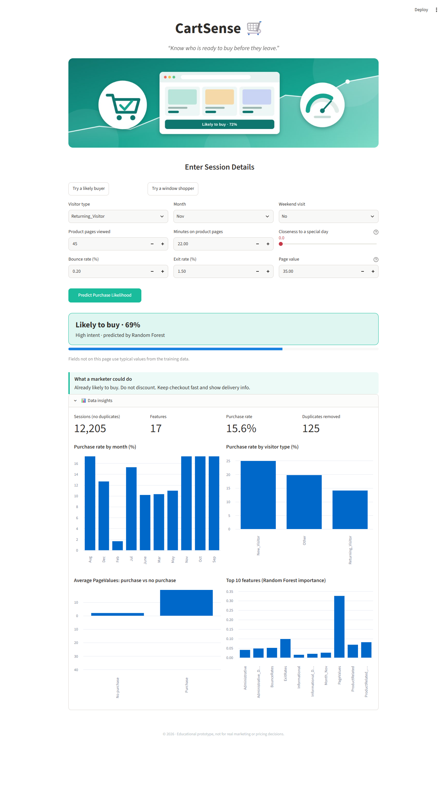

# CartSense 🛒

> *Know who is ready to buy before they leave.*

CartSense is a machine learning web app that looks at what a visitor does during an online-shopping session
(pages viewed, time spent, bounce and exit rates, page value, visitor type, month, weekend) and estimates
how likely that session is to end in a purchase.

⚠️ **Educational prototype.** Trained on one public dataset from a single retailer. Not a live business tool.

### Live Demo
👉 **[Open the app](http://localhost:8501/)**



## Table of Contents
- [Problem](#problem)
- [Dataset](#dataset)
- [Features](#features)
- [How to Use](#how-to-use)
- [Steps Performed](#steps-performed)
- [Results](#results)
- [Run Locally](#run-locally)
- [Project Files](#project-files)
- [Technologies Used](#technologies-used)
- [Limitations](#limitations)

## Problem
Most online stores treat every visitor the same, even though some sessions are clearly headed toward a purchase
and others are not. Getting people to the site costs money, so even a small improvement in converting hesitant
visitors adds up. A marketing team could use a prediction like this to show a discount, open a chat window,
or suggest a product before the visitor leaves empty-handed.

## Dataset
- **Online Shoppers Purchasing Intention Dataset**, UCI Machine Learning Repository
  ([link](https://archive.ics.uci.edu/dataset/468/online+shoppers+purchasing+intention+dataset)), licence CC BY 4.0
- 12,330 sessions, 18 features (behavioural, calendar, technical, visitor type)
- Target: `Revenue` (purchase or no purchase), imbalanced with about 15.5% purchases
- 125 exact duplicate rows removed, leaving 12,205 sessions

## Features
- Enter session details: visitor type, month, weekend, pages viewed, minutes on product pages,
  closeness to a special day, bounce rate, exit rate, page value
- Two example buttons: "Try a likely buyer" and "Try a window shopper"
- Get a **purchase label**, a **probability**, and a **suggested marketing action**
- A collapsed **Data insights** section with purchase rate by month and visitor type, PageValues and feature importance

## How to Use
1. Open the live app, or run it locally.
2. Fill in the session details (or click an example button).
3. Click **Predict Purchase Likelihood**.
4. Read the result: likely or unlikely to buy, the probability, and what a marketer could do.

## Steps Performed
1. **Exploration:** shape, data types, missing values, duplicates, class balance, distributions, and
   purchase behaviour by visitor type, month, weekend, technical features and correlations.
2. **Cleaning:** removed exact duplicate rows.
3. **Split:** 80% train / 20% test (stratified), then 20% of the training part kept as a validation set
   (about 64% / 16% / 20%).
4. **Preprocessing:** standard scaling for numeric features, one-hot encoding for categorical features.
5. **Models:** Majority-class baseline, Logistic Regression, Decision Tree (CART), Random Forest and
   RBF Support Vector Machine, with balanced class weights to handle the imbalance.
6. **Selection:** best model chosen on validation F1-score, then evaluated once on the test set.
7. **Explainability:** Random Forest feature importance and SHAP summary plot (in the notebook).
8. **App:** Streamlit web app built around the trained pipeline.

## Results
Validation set:

| Model | Accuracy | Precision | Recall | F1 | ROC-AUC |
|---|---|---|---|---|---|
| Majority Class Baseline | 0.844 | 0.000 | 0.000 | 0.000 | 0.500 |
| Logistic Regression | 0.849 | 0.513 | 0.731 | 0.603 | 0.888 |
| Decision Tree (CART) | 0.843 | 0.497 | 0.534 | 0.515 | 0.717 |
| **Random Forest** | **0.873** | **0.580** | **0.679** | **0.625** | **0.914** |
| RBF SVM | 0.855 | 0.526 | 0.734 | 0.613 | 0.892 |

Final test set (Random Forest): accuracy 0.895, precision 0.646, recall 0.723, F1 0.682, ROC-AUC 0.924.

Because only about 15% of sessions are purchases, always predicting "no purchase" already gives about 84% accuracy,
so precision, recall, F1 and ROC-AUC are the metrics that matter here.

## Run Locally
```bash
git clone https://github.com/YOUR-USERNAME/YOUR-REPO.git
cd YOUR-REPO
pip install -r requirements.txt
streamlit run app.py
```
The first start takes about a minute because the models are trained on startup.

To run the notebook instead, install `notebook`, `shap`, `matplotlib` and `seaborn`, then open
`CartSense_Notebook.ipynb` in Jupyter or VS Code. It reads `online_shoppers_intention.csv` from the same folder.

## Project Files
| File | What it is |
|---|---|
| `CartSense_Notebook.ipynb` | Full analysis: EDA, preprocessing, models, evaluation, SHAP |
| `app.py` | Streamlit web app |
| `pipeline.py` | The notebook's data preparation and model training code, used by the app |
| `helpers.py` | Small helper functions for the app |
| `online_shoppers_intention.csv` | Dataset |
| `requirements.txt` | Python packages for the app |
| `assets/` | Screenshot or GIF used in this README |

## Technologies Used
- **Python**, **pandas**, **NumPy**
- **scikit-learn** for preprocessing, models and evaluation
- **matplotlib**, **seaborn** and **SHAP** for plots and explainability (notebook)
- **Streamlit** for the web app
- **Git and GitHub** for version control

## Limitations
- One retailer and one period of time
- Session-level data only, no personal information
- Predicted probabilities are not calibrated business probabilities
- Not for real marketing or pricing decisions

## Dataset Credit
Sakar, C. and Kastro, Y. (2018). *Online Shoppers Purchasing Intention Dataset*. UCI Machine Learning Repository. CC BY 4.0.

*Made by [YOUR NAMES] | © 2026*
